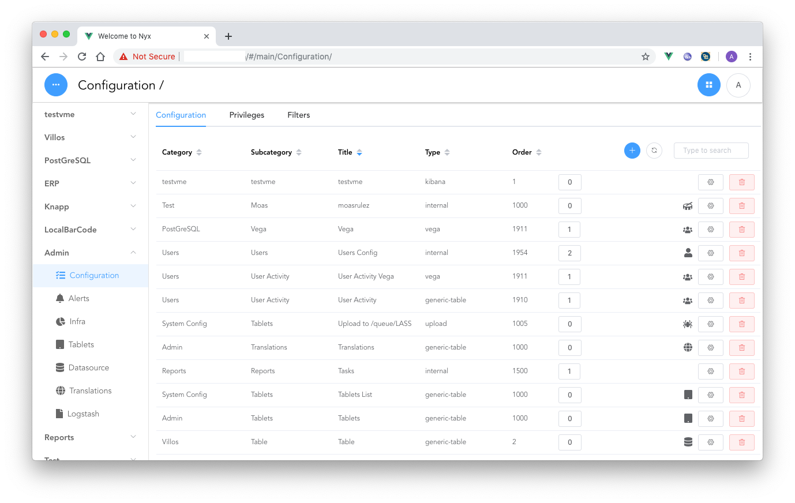
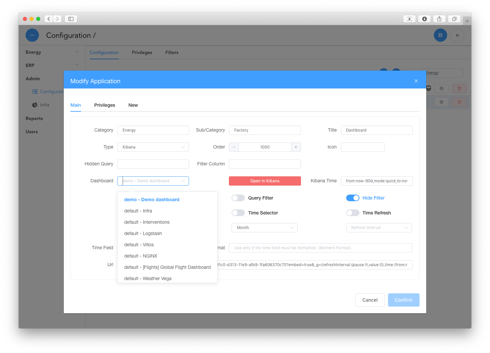
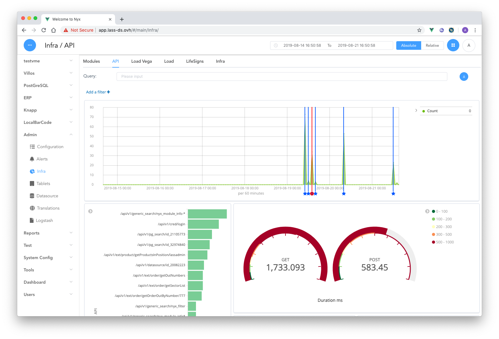
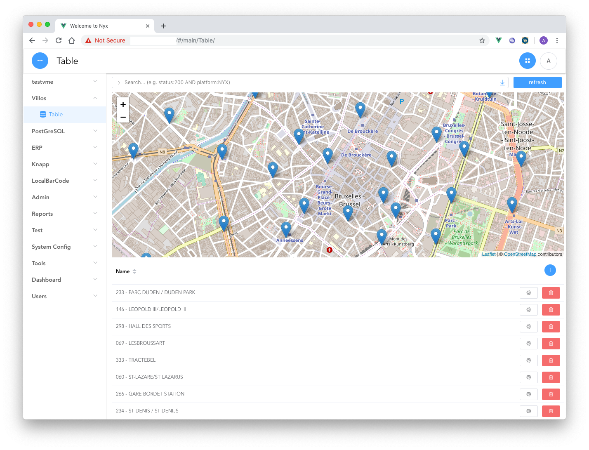
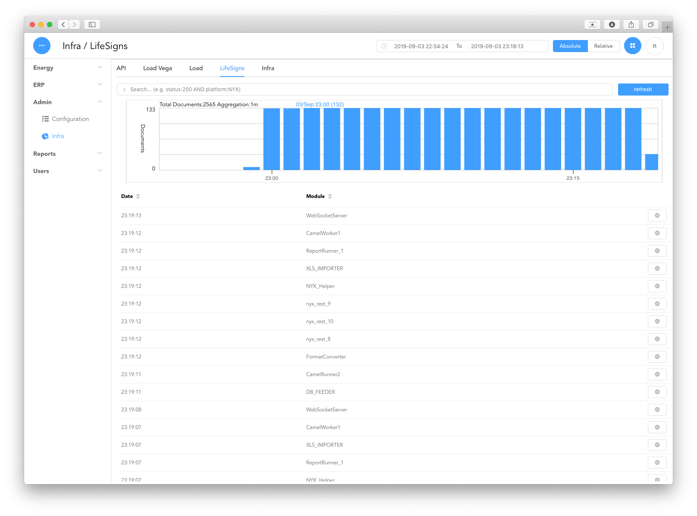
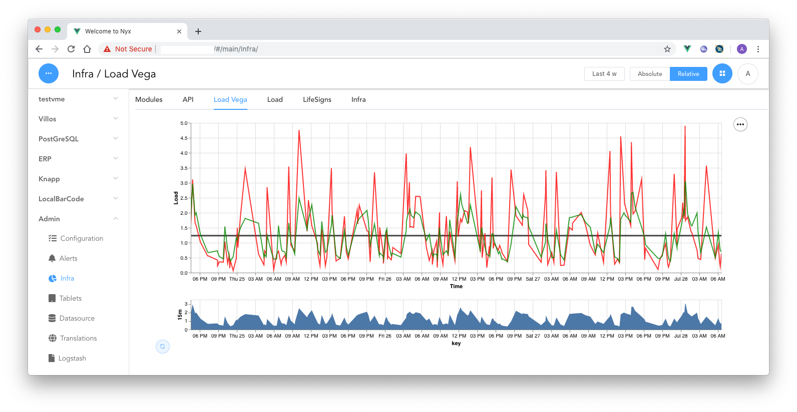

# Nyx User Interface


## Introduction


The NYX platform is an easy to use application builder that integrates various technologies such as:

* Elastic Search / Kibana
* PostGreSQL
* Jupyter Notebooks
* Node Red
* Apache ActiveMQ
* Apache Camel


The NYX UI includes an online configuration tools that can create the following pages:

* A Kibana page
* A generic table page (PostGreSQL or ElasticSearch)
* An in house controller
* An Upload page
* A Form
* A Free Text page
* A Vega graph
* External URLs

### Main Config Table


### An Application configuration panel



### Kibana Panel:

A kibana panel is directly linked to a kibana dashboard. It is possible to change the time selector and query the Kibana panel editor.




### Generic Table:

A generic table is a view on:

* An Elastic Search Collection
* A PostgreSQL table or Query

It can include:

* a discover graph
* a map
* a query
* download options




### Vega Panel:

A Vega panel uses the Vega framework in order to build interactive dashboard.




## Project setup
```
npm install
```

### Compiles and hot-reloads for development
```
npm run serve
```
Lauching application

==> http://localhost:8080/?api=https://YOUR_REST_API_SERVER/api/v1/&user=admin&password=*******#/

Rest API swagger

=> Rest API swagger https://YOUR_REST_API_SERVER/api/doc/


### Compiles and minifies for production
```
npm run build
```

### Tests

```
npm test              # suite complete (logique + ecrans)
npm run test:coverage # idem, avec le rapport de couverture
```

Deux environnements cohabitent dans la meme suite : `node` pour les modules de logique et le
store, `jsdom` pour les ecrans montes (le fichier de test le declare en tete :
`// @vitest-environment jsdom`). Les composants Element Plus, le routeur memoire, l'i18n et les
globals de `src/main.js` sont fournis par `tests/helpers/mount-view.js`.

La couverture porte sur tout `src` (javascript et `.vue`). Les seuils de `vitest.config.mjs` sont
par glob : 97/96/94/97 sur le javascript de logique, 85/80/50/85 sur `src/views`, 13/68/23/13 sur
`src/components` et un seuil global bas qui sert surtout a reperer un fichier de test perdu.

Etat au 9 novembre 2026 : **608 tests**, **34,75 %** des instructions de `src` (7 464). Par zone :

| zone | statements | branches | remarque |
|---|---|---|---|
| `src` (racine : `main`, `App`, i18n) | 62,5 % | 45,6 % | |
| `src/router` | 100 % | 91,7 % | |
| `src/store` | 98,9 % | 95,0 % | |
| `src/utils` | 99,6 % | 96,0 % | |
| `src/views` | 75,4 % | 75,3 % | Login 79,7 · Main 64,7 · OAuth 100 · Privacy 100 |
| `src/components` | 26,1 % | 31,4 % | les écrans montés tirent le chiffre vers le haut, les éditeurs restent peu couverts |

Les composants non testes tirent le chiffre global vers le bas : c'est la mesure honnete, pas une
regression. Prochaines cibles par taille et par risque : les éditeurs d'application
(`appConfigEditor/ESTableEditor`, `ConfigDetails`), `ReportGenerator` / `ReportTask`,
`GenericTableDetails` (edition d'un enregistrement), `NYXInfo`, `PGGenericTable`.

### Dependances

`npm audit` signale 17 vulnerabilites (10 hautes, 7 moyennes) au 9 novembre 2026, contre 25 avant
le lot de corrections du jour. Ce qui part dans le navigateur et ce qui ne quitte pas la chaine de
construction n'ont pas le meme poids :

| paquet | d'ou il vient | etat |
|---|---|---|
| `postcss`, `serialize-javascript`, `minimatch`, `uuid` | outillage de construction | **corriges** — les `overrides` de `package.json` les forcent a la version remediee (8.5.23, 7.1.3, 11.0.1, 11.1.1). Build de production et 608 tests verifies |
| `webpack-dev-server`, `webpack-dev-middleware` | `@vue/cli-service` 5, uniquement `npm run serve` | rien dans cette version : vue-cli 5 exige `webpack-dev-server` 4, les avis sont corriges en 5.2. La console servie n'est pas concernee |
| `@vue/cli-*`, `cross-spawn`, `execa`, `yorkie`, `glob`, `js-beautify` | meme outillage | `npm audit` ne propose qu'un **retour** a vue-cli 3.12 : aucune version remediee n'existe dans la 5. Construction et tests, jamais executes dans le navigateur |
| `vue-i18n` 9.14.5 (+ `@intlify/*`) | **le bundle servi** | 9.14.5 est la derniere de la serie 9 (etiquette `legacy9`), qui n'est plus maintenue : GHSA-83rm-6c8r-g728 n'est corrige qu'a partir de 11.4.14 |

L'exposition de `vue-i18n` est nulle en pratique aujourd'hui : les messages sont des fichiers JSON
du depot, aucune chaine traduite n'est construite a partir d'une saisie, et `escapeParameter` n'est
pas utilise. Passer a la 11 supprime le mode `legacy` : `$i18n.locale` devient une ref, donc chaque
lecture et chaque ecriture — `this.$i18n.locale` dans quatre ecrans, le `watch` de `App.vue`, les
tests qui lisent la locale — doit dire `.value`. C'est une migration a mener pour elle-meme, pas un
correctif d'urgence.

### Extending the UI

To add a new specific controller:

=> put a new .vue file inside the folder components/external

To add a new specific table editor:

=> put a new .vue file inside the folder components/tableEditor

### Building the container

The build and runtime stages use Node.js 22 LTS. Vega-Lite 6.5 and newer require Node.js 22 or newer.

```
docker build .
```

### Version History

Current version: **v3.29.30** (24/Oct/2026).

* Fixed table header inputs (configuration filter/search) by restoring scoped header slots.

[Versions](versions.md)
