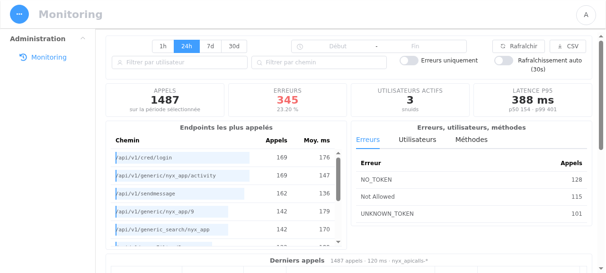
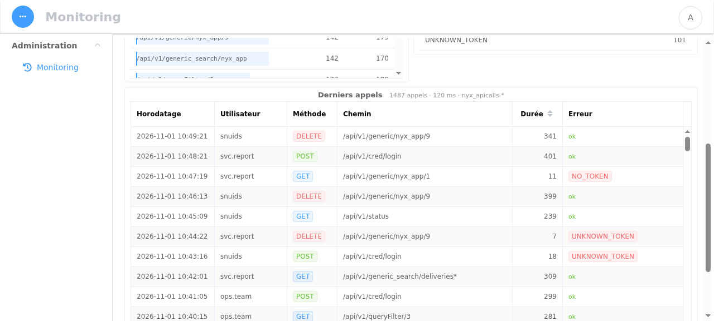

# Example `nyx_app` documents

NYX is metadata-driven: a screen exists because a document exists in `nyx_app`. The files in
this folder are ready-to-use documents for the internal controllers shipped in
`src/components/`. They are **not** loaded automatically.



The page reads `nyx_apicalls-*`, the audit trail the API already writes on every authenticated
call: exact call/error counters, latency percentiles, the most called endpoints, errors and
users, then the last 200 calls. 

## Create the Activity page

The `Activity` component reads the API audit trail that every `@token_required` route already
writes to `nyx_apicalls-YYYY.MM.DD`. Two documents are needed.

1. The page itself — `docs/apps/activity.json`:

```shell
curl -k -X POST "https://HOST/api/v1/generic/nyx_app/activity?token=$TOKEN" \
  -H "Content-Type: application/json" \
  --data @docs/apps/activity.json
```

The `_id` of the document (`activity` above) becomes the `rec_id` used by the menu link, so
pick a stable name. In the console the same document can be created from
*Config → add application* with type `internal` and `config.controller = "Activity"`.

2. Access control — a `nyx_indice` document, otherwise the index is not covered by the
   privilege rules:

```json
{ "indicepattern": "nyx_apicalls.*", "privileges": ["admin"] }
```

```shell
curl -k -X POST "https://HOST/api/v1/generic/nyx_indice/nyx_apicalls?token=$TOKEN" \
  -H "Content-Type: application/json" \
  --data '{"indicepattern":"nyx_apicalls.*","privileges":["admin"]}'
```

`privileges` here is an any-of list matched against the user's privileges (`admin` always
matches the app-level check, the index check compares list membership). Do not add a
`filtercolumn` to this pattern: the trail is already scoped by the index-level privileges and
admins are expected to see every user.

3. Reload the menus (`/api/v1/reloadconfig` is called by the console on login; the index and
   translation caches refresh every 60 s).

## Notes

- The component tolerates the absence of `url.keyword` / `error.keyword` sub-fields: it reads
  the mapping through `/api/v1/esmapping/` and adapts the terms aggregations.
- The range defaults to the last 24 h; `1h`, `7d` and `30d` presets and a custom range are
  available, plus a CSV export that goes through the API's normal export path (larger exports
  are mailed by `nyx_rest_helper`).
- Elasticsearch only keeps what the Curator configuration keeps: if `nyx_apicalls-*` is pruned
  aggressively, widen `nyx/curator/action_file.yml` accordingly.
